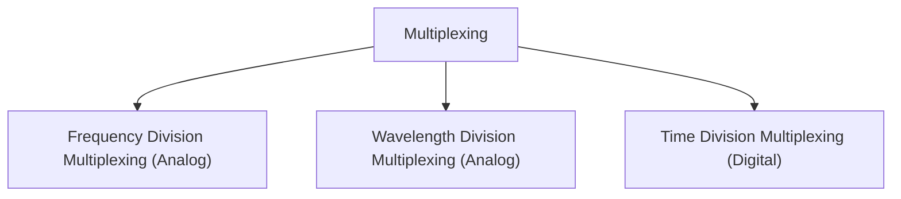

# Bandwidth Unilization



Multiplexing : transmission of multiple signal on same link

1. FDM : when bandwidth of individual signals combined is less than the link's bandwidth
  1. example 

```
total bandwithd : 1MHz
4 digital channels of 1Mbps input -> 250KHz to each
 we need to fit 1Mbps bitrate into 250KHz baudrate therefore we need 4 bit quantization
so we can use 16QAM to quantize those 4 bits
```

2. WDM : used in fiber optic cable for highdata rate capacity     same as FDM but with light
3. TDM : each input signal gets full bandwith for its time slice of link
  1. example 

```
n-channels with say x Mbps bitrate = 1/x micro seconds duration 
therefore : 1 frame  = 1/x microseconds
1 frame is divided into n parts where each signal gets 1/n part of frame
therefore : each signal gets 1/(x*n) microseconds to transmit 
but the prevent buffering the link bitrate is n*single signal bitrate
therefore each signal gets 1/x time same as it want to transmit
```

Types of multiplexing 

1. empty slot multiplexing
2. multilevel multiplexing
3. multislot multiplexing
4. pulse stuffing multiplexing

Spread Spectrum : for resistence from jamming

data is redundantly spready over wider bandwidth

1. Frequency Hopping SS : each frame is transfered over different freq which is repeated cyclicly
2. Direct Sequence SS : a sequence is maintained   1 (signal) 0 (inverted signal) on n-channels where n = bits in signal 

 