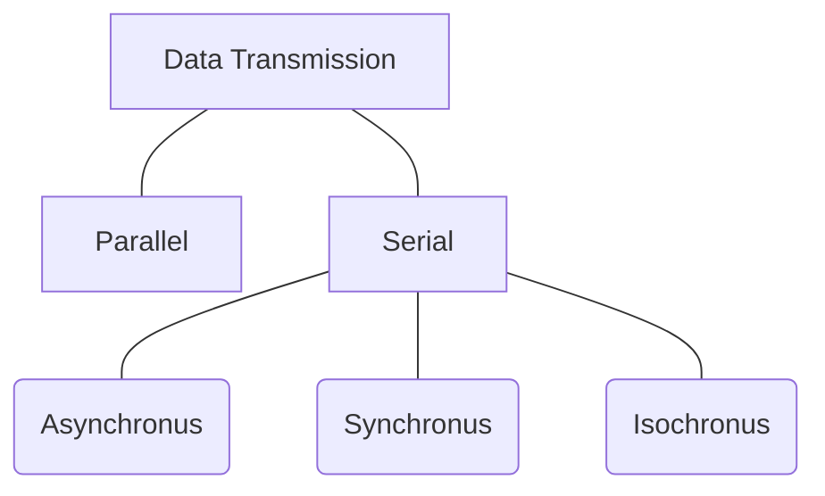
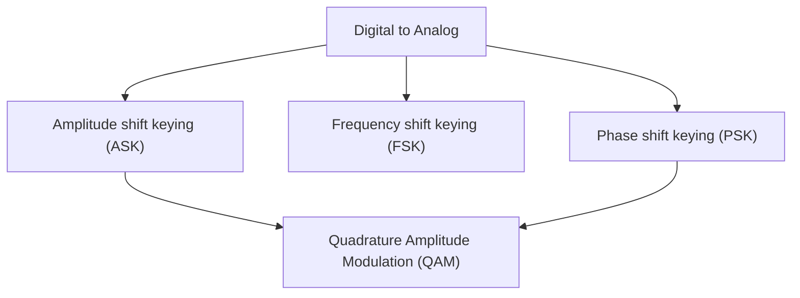
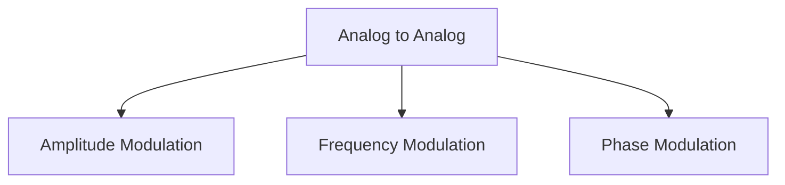

# Signal Formulas

Datarate : N

Signal rate : S

conversion cases

1. worst case : signal rate is max
2. avg case : this is where we are interested
3. best case : signal rate is min

Signal Rate : no. of signals per time period

$$
S_{avg} = \frac{c * N}{r}
$$

```
c : case factor
N : bitrate
r : previously defined ( data elements / signal )
```

Baseline : moving avg of signal to compare the current signal value against

Baseline wandering : when long sequence of 1's or 0's more avg towards them which can result in bad data reading

DC components : avg value of signal over time

Self- Synchronization : data transmitted helps synchronize clock between sender and reciever

### Digital to Digital

Nyquist formula for bitrate (noiseless)

$$
B_{min} = \frac{R}{ 2}
$$

$$
R_{max} = 2B log_2 L
$$

```
R_max : maximum bitrate for ideal noiceles low-pass channel
B : bandwidth
L : levels of bits in digital signal
```

Shannon formula for bitrate (noisy)

$$
Capacity = Blog_2{(1 + SNR)}
$$

$$
Capacity = Blog_2(1 + 10^{\frac{SNR_{dB}}{10}})
$$

```
Capacity : maximum bitrate
B : bandwidth
SNR : signal to noise ratio
```

power loss attenuation

$$
Signal Loss (dB) = 10log_{10}\frac{P_2}{P_1}
$$

```
P2 : power currently (Watts)
P1 : power previously (Watts)
```

why is decibals ? cause it is additive over a series of changes

Distorsion : change in the phase of signal due to different time of arrival

Noise

1. Thermal noise
2. induced noise
3. cross talk
4. impulse noise

Signal to noise ratio

$$
SNR = \frac{Signal Power}{Noise Power}
$$

$$
SNR_{dB} = 10Log_{10} SNR
$$

Latency : how much time it takes from first bit transmissted to entier signal reaching estination

$$
Latency = TransmissionTime + PropogrationTime + QueueingTime + ProcessingDelay
$$

Throughput : actually how much data can be transfered over timeperiod

```
maximum bitrate can be find from shannon or nyquist formula but there is a limit on how much data on avg can be transfered let it be ( x frames/ time period )
```

$$
Throughput = \text{Avg bits transfered over time}
$$

$$
ActualBitrate < MaximumBitrate
$$

```
S : baud rate (signals/sec)
N : bitrate (bits/sec)
c : avg. no of signal per data element relative to max
r : no. of data element represented by one signal element
```

$$
N_{max} = B * r * (1/c)
$$

Line coding schemes

1. Unipolar : NRZ
2. Polar : NRZ, RZ, manchester, differencial manchester
3. Bipolar : AMI,psuedoternary
4. Multilevel : 2B/1Q, 8B/6T, 4D-PAM5
5. Multitransition : MLT-3
6. Unipolar
  1. NRZ : 1 (some volatage V), 0 (0 voltage)     normalized power = 1/2 V^2
7. Polar
  1. NRZ-Level : 1 (V1 voltage ) 0 (V2 voltage)
  2. NRZ-I : 1 (signal changes level at beginning of interval), 0 (signal remains same)     1 : go from low to high or high to low     0 : remain on the same level
  3. RZ : 1 (+V for first hald of interval then 0)  0 (-V for first half of the interval then 0)
  4. manchester : 1 (low to high transission in middle) 0 (high to low transission in middle)
  5. differencial manchester : 1 (no transission change ) 0 (transission change)
8. Bipolar
  1. AMI : 0 (0 volts) 1 (V volts but in different direction than previous 1 signal)
  2. psuedoternary : 1 (0 volts) 0 (V volts but in different direction than previous 1 signal)
9. Multilevel
  1. 2B1Q : 2-bit signal requires 2^2 levels each encodes different value eg. (00 : 3V, 01 :1V, 10 : -1V, 11 : -3V )
  2. 8B6T : 8 bits of data in 6 signal elemets using 3 voltage levels (+V,0,-V) since 8 bits value can range from 0-255 and 3 voltage levels 6 time can create 3^6 = 729 different values
  3. 4D-PAM5 : used in gitgabit ethernet 1000base-T (4D -> 4 wires pairs)(PAM -> pulse amplitude modulation) (5 -> voltage levels) 5^4 = 625 levels
10. Multitransission
  1. MLT-3 : (3 -> voltage levels +v,0,-v) 1 (transission to next level) 0(remain at same level) sequence = (0 -> +v -> 0 -> -v -> 0)


Scrambling methods 

1. B8ZS (bipolar with 8-zeros substitution) : used with bipolar AMI (used cause long sequence of 0's can cause asyncronization)
  1. replace every consecutive 8 zeros with
    1. if last 1 was +V : 0 0 0 + - 0 - +
    2. if last 1 was -V  : 0 0 0 - + 0 + -
2. HDB3 (high-density bipolar 3-zeros) : for any consecutive 4 zeros , find the no. of 1's befor it
  1. if no. of 1's is odd : replace with ( 0 0 0 V )
  2. if no. of 1's is even : replace with ( B 0 0 V )
  3. B : pulse opposite of last pulse's direction
  4. V : pulse same of last pulse's direction

### Analog to digital

pulse code modulation steps

1. sample (ideals sample rate = 2*bandwidth)
  1. ideal sampling (only at that time instance)
  2. natual sampling (sample but data flows with signal)
  3. flat-top sampling (data stays as it got sampled)
2. quantize : categorize signal in categories
3. encode : assign numerical value to each category and binary represent it

Signal to noise ration here

$$
SNR_{dB} = 6.02(r) + 4.76
$$

```
r : no. of bits to represent a level
```

delta modulation (1bit/sample)

1. only see difference from previous state after a delay,
  1. if signal is higher then current -> step up -> 1
  2. if signal is lower then current -> step down -> 0

### Data transmission in medium



1. Parallel : n bits together sent via 8 lines
2. Serial : 1 channel
  1. asynchronus : [ startbit | payload | stopbit ]
    1. gaps between each group
    2. no sender reciever continuous clock
  2. sychronus :
    1. shared or recovered clock required
    2. data transmissted in organized frame or block
    3. continuous data tranmission
  3. Isochronus :
    1. data at predefined time intervals
    2. controlled or gaurented timing relationship
    3. when timly delivery is more importatnt

### Digital to Analog (its all about Modulators)



$$
S = \frac{N}{r}
$$

```
S : baudrate
N : bitrate
S <= N
```

1. ASK : amplitude of signal is changed based on digital data    1 (amplitude non-zero). 0 (amplitude 0)
  1. Implementation : analog signal = multiplier(occilator, digital signal)

$$
here,
\newline
r = 1
\newline
\therefore S = N
\newline
\text{and }B = (1 + d) * S
$$

```
d : modulation dependent varies between 0 and 1
```

2. FSK : frequence is changed based on digital data    1 (f1 freq)    0 (f2 freq)
  1. Implementation : analog signal = voltage constrolled occilator(digital signal)
    $$
    here,
    \newline
    r = 1
    \newline
    \therefore S = N
    \newline
    B = (1+d)*S + 2\Delta f
    $$
    ```
    delta f = deviation from carrier frequency of both frequencies
    carrier freq : mid of bandwidth range
    f1 = carrier freq - delta f
    f2 = carrier freq + delta f
    ```
3. PSK : phase is changed based on digital data 1 (p1 signal) 0 (p2 signal)
  1. implementation : analog signal = p1 signal if bit == 1 else p2 signal

$$
here,
\newline
r = 1
\newline
\therefore S = N
\newline
\text{and }B = (1 + d) * S
$$

```
for more than one bit / signal -> do summation of signal generated by PSKing different bit from bits seperatly

QPSK : 2bit PSK ( 2^0 bit signal + 2^1 bit signal )
```

$$
here,
\newline
r = 2
\newline
\therefore S = N/2
\newline
\text{and }B = (1 + d) * S
$$

Constellation diagram : x-axis (in-phase carrier) amplitude of one componenet, y-axis (quadrature carrier) amplitude of q component

vector of length = amplitude and angle = phase

4. QAM : combining ASK and PSK because PSK s difficult to differenciate between change
  1. eg. 4-QAM : 4 signal level of different phase , different amplitude

### Analog to Analog

why we need it ? it is needed when medium is bandpass in nature or only bandpass channel is available which is most of the time



1. Amplitude modulation
  1. Implementation : new analog signal = multiplier(old analog signal, occilator)

$$
B_{AM} = 2f_m
$$

```
fm : frequency of modulating signal (the input signal)
fc : carrier freqnecy
2 : because it modulated in both direction of carrier frequency 
```

2. Frequency Modulation
  1.  Implementation : new analog signal = voltage constrolled occilator(old analog signal)

$$
B_{FM} = 2(1+b) B_m
\newline
b = \frac{\Delta f}{B}
\newline
\Delta f = \text{maximum frequency deviation}
\newline
\therefore B_{FM} = 2(\Delta f + B)
$$

```
B : max frequency of old signal
delta f : how far carrier frequency changes fom original frequency
```

3. Phase Modulation
  1. Implementation : new analog signal = voltage constrolled occilator(d (old analog signal) / dt)

$$
B_{PM} = 2(1+b_p) B_m
\newline
b_p = \text{peak phase deviation}
\newline
b_p = k_pA_m
\newline
k_p = \text {phase sensitivity}
\newline
A_m = \text{max modulating signal amplitude}
$$

 