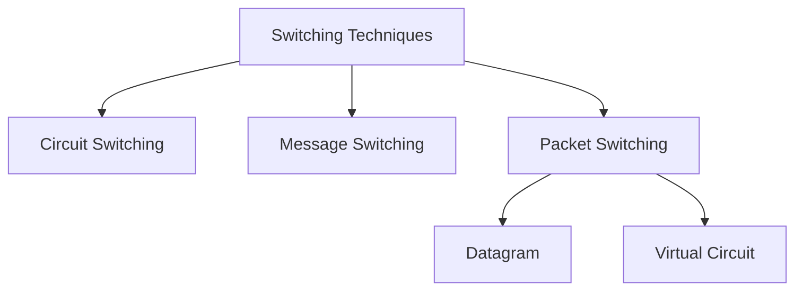

# Switching and DLL

connect multiple devices for comms



Switching at different layers

1. physical layer : CS
2. DLL : PS -> virtual circuit
3. NL : PS -> cirtual or datagram
4. AL : MS

1. circuit swithcing : dedicated channel for comms between 2, connection setup, data transfer, teardown
  1. delay = connection + transmission + teardown
2. Packet switching : packet made , packet passed though network to dest in any route
  1. Datagram : each packet aka datagram are treated as independent, sequence is needed
    1. at each switch table is maintained of  : dest addr <-> output port no.
    2. delay for n switch in route = n*transmission time (time between device 1'st and last bit) + n*propogration time(time to reach a hop) + (n-1)* waiting time
  2. Virtual circuit : same path for all packet , local jurisdiction of addr
    1. addr types : local and global,    VCI/local : switch scope      global : network scoped
    2. table at switch : incomming port, incomming VCI, outgoing port, outgoing VCI
    3. delay = steup + transmission + teardown

Switch design example

```
N x N (N = 200) switch k = 4, n = 20

200/20 = 10 crossbar or 20 in x 4 out
4 crossbars of 10 in x 10 out
10 crossbars of 4 in x 20 out

total crosspoints = 2kN + k*(N/n)^2 = 1600 + 400 = 2000
```

```
with clos criteria
n = root(N/2) = 10
k = 2n - 1 = 19

N/n count of n x k
k count of n x n
N/n count of k x n


therefore
200/10 = 20 crossbar of 10 in 19 out
19 crossbar of 10 in 10 out

total = 20*2*10*19 + 100 * 19 = 7600 + 1900 = 9500
```

banyan switch

 

### DLL

Hosts, nodes links

services : it gives service to network layer and takes service from physical layer

links : point to point or broadcast

DLL can be diivided into 2 parts

Frame : {dest MAC | src MAC | src IP | dest IP | payload )

1. Data link control
2. media access control (only in braodcast)
  1. Uses MAC address
    1. unicast : 48bits or 6 bytes (8th bit set) 
    2. multicast : 48bits or 6 bytes (9th bit not set)
    3. broadcast : 48 bitst all set
  2. ARP packet (32*6 = 196bits or 24 bytes)
    1. 0-15 hardware type
    2. 16-31 protocol type
    3. 2 byte harware and protocollength each
    4. 2 byte operation req : 1 rep : 2
    5. 4 byte each for src/dest harware/protocol addr

 