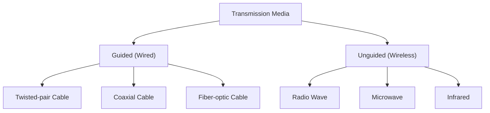

# Transmission medium

1. Guided
  1. Twisted pair : twisted to counter noise, pair for signal reference
    1. Types
      1. UTP : cover { 2 covered conductors }
      2. STP : cover { metal shield { 2 covered conductors } }
    2. Connectors : RJ45
    3. Performance : poor over 100KHz depending upon gauge
    4. Ratings

      | Spec               | Mbps | use       |
      | ------------------ | ---- | --------- |
      | UTP telephone      | <0.1 | telephone |
      | UTP T-line         | 2    | T-1 line  |
      | CAT2               | 10   | LAN       |
      | CAT3               | 20   | LAN       |
      | 24 AWG with jacket | 100  | LAN       |
      | CAT5E              | 125  | LAN       |
      | CAT6               | 200  | LAN       |
      | CAT7               | 600  | LAN       |

  2. Coaxial cable : cover { insulator { metal/outer conductor { insulator { iiner conductor } } } }
    1. Connectors : BNC-(cable to cable), BNC-T (cable joint), BNC-terminator (cable end)
    2. Performance : poor over 1MHz depending upon gauge and worese over twisted pair
    3. Ratings

      | Type  | impedence | use            |
      | ----- | --------- | -------------- |
      | RG-59 | 75 ohm    | cable tv       |
      | RG-58 | 50 ohm    | thin ethernet  |
      | RG-11 | 50 ohm    | thick ethernet |

  3. Optical Fiber : transmission over light     cover{ kevlar cover { plastic buffer { cladding { core } } } } 
    1. Transmission mode
      1. single mode : small core, large cladding , straight light
      2. multimode
        1. step index : different critical angle different signals
        2. gradient index : core to cladding smooth gradient of refractive index
    2. Connectors 
      1. Subscriber channel : cable tv, push lock
      2. Straight tip : networking, twist lock
      3. MT-RJ : same size as RJ45
    3. Types

      | type     | core (micro meter) | cladding | use                |
      | -------- | ------------------ | -------- | ------------------ |
      | 50/125   | 50                 | 125      | multimode gradient |
      | 62.6/125 | 62.5               | 125      | multimode gradient |
      | 100/125  | 100                | 125      | multimode gradient |
      | 7/125    | 7                  | 125      | single mode        |

2. Unguided
  1. types 
    1. radio : 3KHz - 300 MHz omnidirectional
    2. micro : 300MHz - 300GHz unidirectional
    3. Infra : 300GHz - 400THz short range comms
  2. Propogation
    1. ground :  < 2MHz
    2. ionospher : 2-30 MHz
    3. lineof sight : 30MHz
  3.  

    | band | range       | propogation | use                       |
    | ---- | ----------- | ----------- | ------------------------- |
    | VLF  | 3-30 KHz    | ground      | long range radio          |
    | LF   | 30--300KHz  | ground      | radio beacon              |
    | MF   | 300KHz-3MHz | sky         | AM                        |
    | HF   | 3-30MHz     | sky         | citizen and aircraft band |
    | VHF  | 30-300MHz   | sky and LOS | VHF TV FM                 |
    | UHF  | 300MHz-3GHz | LOS         | UHF TV cellphone satelite |
    | SHF  | 3-30GHz     | LOS         | satelite                  |
    | EHF  | 30-300GHz   | LOS         | radar satelite            |

 